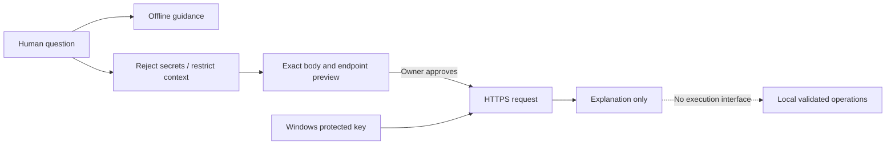

# AI integration

Local deterministic discovery, SQL validation and recovery do not require AI. `LocalAssistant` provides offline explanations. The optional `AiAssistant` adapter accepts an HTTPS chat-completions-compatible endpoint and explicitly configured model. Provider-specific Responses, streaming, tool calling and arbitrary protocol adapters are not implemented. No API key is bundled or discovered from other applications.

`Prepare` builds a request from a short user question and allowlisted version/status fields. Paths, email addresses and URLs in questions are removed; obvious credential assignments, keys, hashes and PHP source are rejected. Sanitization is defense in depth: it cannot detect every possible secret in arbitrary prose. The owner must inspect the exact preview. Configuration files, user tables, password hashes and raw diagnostics are never automatically attached.

`SendAsync` requires a matching, unexpired, one-use approval ticket for the exact endpoint and body. HTTP redirects and cookies are disabled; requests have a 30-second deadline and responses a 64 KiB limit. Provider error bodies are not echoed. API keys are sent only in the authorization header to the selected endpoint. The provider can charge for requests, including the GUI connection test, which uses the same preview approval boundary.

Mocked HTTP tests cover disabled mode, tampering, replay, cancellation, errors and disclosure. No live provider request is required for testing. Compatibility with a specific provider/model must be verified by the owner after configuration. Disconnect disables cloud functionality and can remove the app-owned saved key. Changing provider does not authorize an automatic request.
