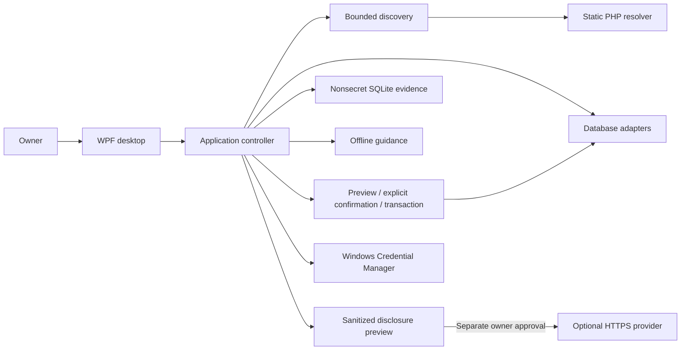
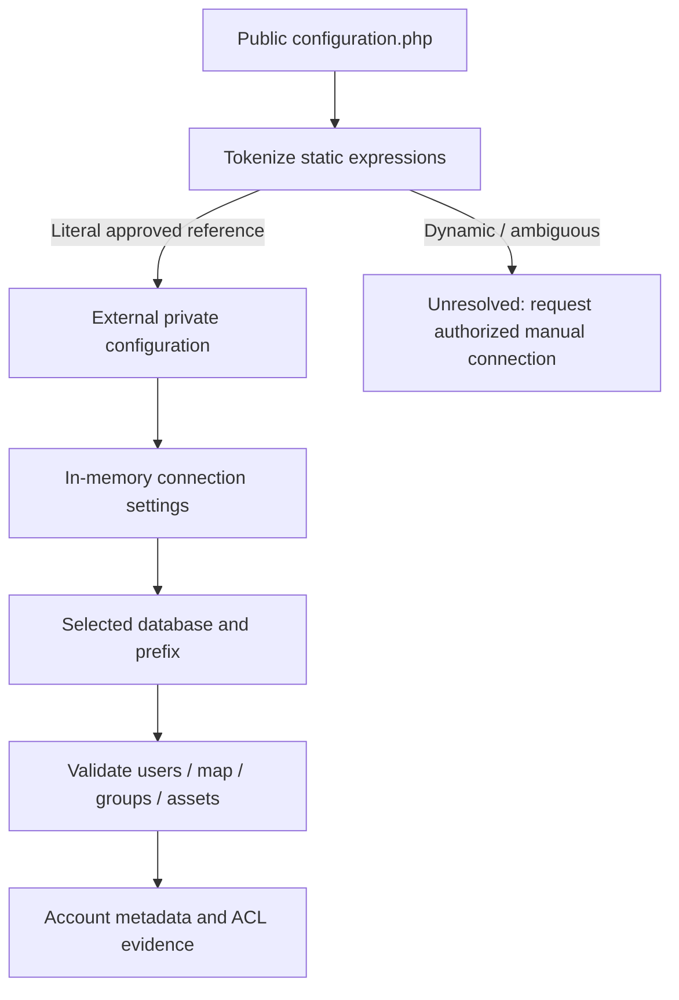
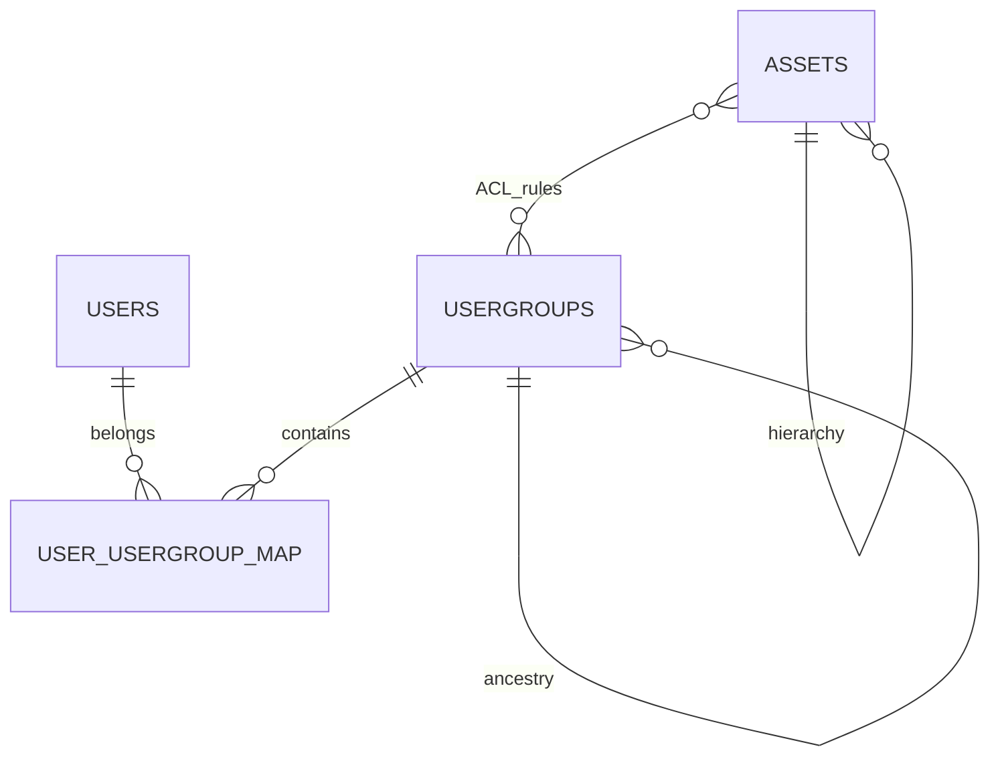
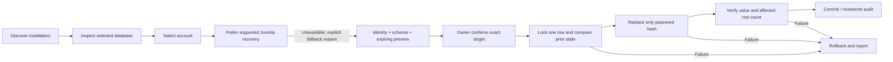
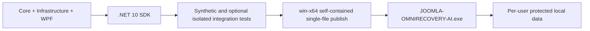

# Architecture

WPF provides a native, accessible Windows interface using the installed .NET 10 toolchain. A C# backend avoids packaging a second Python runtime. MySqlConnector provides parameterized database access; Microsoft.Data.Sqlite stores evidence and isolated test fixtures; BCrypt.Net-Next implements PHP-compatible bcrypt. These dependencies are project-local. Runtime operation has no dependency on Codex, PowerShell, XAMPP's control panel, or other engineering repositories.

`OmniRecovery.Core` contains contracts, status records and stable identities. `Infrastructure/Discovery` has filesystem and system adapters. `Database` owns schema validation, SQL allowlisting, ACL interpretation and transaction boundaries. `Recovery` owns version/password policy and one-use confirmation. `Security`, `Evidence`, `Ai` and `Services` have independent contracts. `Desktop` owns navigation, display, selection and explicit user interactions. Tests exercise these boundaries without starting unknown application scripts.

The resolver never evaluates configuration PHP. Unknown or conflicting constructs remain unresolved. Secret fields are excluded from JSON serialization; no private configuration source is copied into reports.

No service listens on behalf of this application. Cloud providers receive a deliberately small approved request and cannot invoke local tools. Account data and filesystem access remain local. Remote database connections require separate opt-in and verified TLS; ordinary connections are loopback-only.

Runtime data is under `%LOCALAPPDATA%/JoomlaOmniRecoveryAI/user`; demo data is under the separate `demo` directory. Evidence history and settings have current-user/SYSTEM ACLs. Credentials live in the current user's Windows Credential Manager. Managed strings cannot guarantee immediate physical zeroization; secrets are minimized and never intentionally logged. Native save buffers are cleared.
