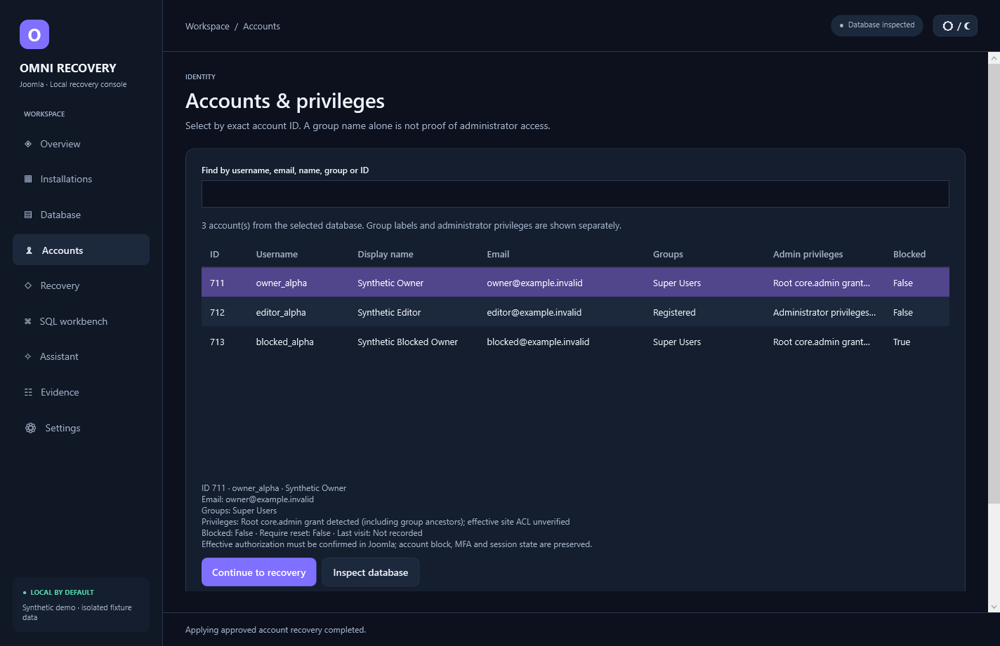

# Joomla OmniRecovery AI

A Windows desktop application for discovering local Joomla installations, resolving their configuration, identifying administrator accounts, and reviewing a precisely scoped password reset. Local operation does not require an AI provider or Codex.

**Version 1.0.0 · Windows x64 · .NET 10 / WPF**

Start `release/JOOMLA-OMNIRECOVERY-AI.exe`, review the folders in Settings, and choose **Scan approved folders**. Nothing connects to a database or resets an account merely because the application opens. Use `Launch-Demo.cmd` for two disposable training installations.

## What is implemented

- Bounded, cancellable discovery; multiple installation identities; static configuration-loader resolution, including approved external configuration files.
- Apache configuration/port/alias inspection, PHP discovery and service/listener observations. Existing server settings remain unchanged.
- Authorized MySQL/MariaDB connections, schema/prefix validation, nonsecret account tables, group ancestry and ACL evidence. SQLite supports inspection and isolated training fixtures; it is not claimed as a supported Joomla production database.
- Restricted SELECT workbench with preview and parameterized values. It cannot execute arbitrary SQL, hashes or recovery writes.
- Joomla 4/5 bcrypt recovery fallback with explicit owner confirmation, an expiring account-specific preview, transactional single-row update and verification. Supported Joomla recovery is recommended first. Passwords are not decrypted.
- Local evidence SQLite, JSON/CSV exports, Windows Credential Manager, offline guidance, and optional preview-approved HTTPS AI assistance.
- Native dark/light GUI; self-contained Windows release configuration; synthetic automated and database integration tests.

## Start here

[Installation](INSTALLATION.md) · [User guide](USER-GUIDE.md) · [Recovery boundaries](ACCOUNT-RECOVERY.md) · [Security](SECURITY-BOUNDARIES.md) · [Validation and limitations](TESTING.md) · [Mermaid diagrams](docs/diagrams)

The support range is deliberately bounded: recovery permits Joomla 4.x/5.x schemas; Joomla 3, 6 and unknown versions fail closed. Cross-version end-to-end Joomla authentication has not been established. See the test report for precisely what was verified. MFA, blocked status, sessions and external identity providers are separate concerns; a password reset does not guarantee login.

## Develop

PowerShell 7 and .NET SDK 10.0.404 or a later installed 10.0.4xx patch are required by the pinned build configuration. Runtime users use the self-contained release. `./Build.ps1` restores project-local NuGet packages, runs synthetic tests, and publishes the desktop application. `./Start-Development.ps1 -Demo` launches a training session. No existing application, service, database schema, repository or global PATH needs modification.

The source is independent of the other engineering projects on the development workstation. [Architecture](ARCHITECTURE.md) explains the module boundaries. No public API key, real database credential, private Joomla configuration, password hash or local investigation history belongs in this repository.
