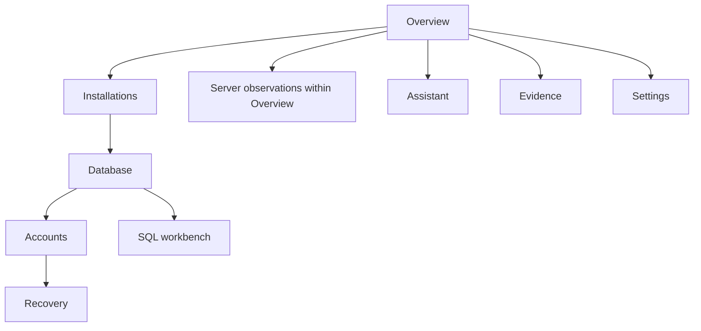

# User guide

## Discover and inspect

1. Open Settings and review the permitted root folders. Add personal folders only when you choose to inspect them. Select depth and time limits; keep dependency caches and unrelated data excluded.
2. Run discovery in Installations. Progress shows current work; Cancel requests a safe stop. A partial result is not proof that no other installation exists.
3. Select an installation. Review its version, configuration reference chain, status and findings. Approve a specific external configuration file if it lies outside the permitted roots. Dynamic configuration requires manually supplied authorized connection details; the application never executes it.
4. Review the database name, prefix, endpoint and authentication fields. Use the application's existing connection or supply an authorized account. Saving a credential is optional and uses Windows Credential Manager.
5. Connect. Database tables and account metadata appear in Database and Accounts. Select an account to see its groups, blocked/reset status and administrator privilege evidence. Group titles alone are not proof of authorization.

## Recover an account

Prefer Joomla's supported recovery or another authorized Super User. If those methods are unavailable, choose the reviewed database fallback, enter a reason, and confirm you own or administer this installation. Generate a new password or enter one twice. Generated passwords may be revealed briefly for transfer to your password manager; treat the screen as sensitive. Review the database, table, username, account ID and one-row operation. Confirm the exact displayed phrase and apply the reset. The application reports whether the transaction committed and the record matched. It does not clear MFA, unblock accounts, terminate sessions or reset other accounts. See [Account recovery](ACCOUNT-RECOVERY.md).

## SQL and diagnostics

The SQL workbench accepts a small SELECT grammar over approved nonsecret tables and columns. Preview before executing; change the text and preview again. Copy SQL or export a result only when you intend to disclose those account details. phpMyAdmin opens as a normal browser link: the application neither reuses browser cookies nor scrapes authenticated pages. Server observations are on Overview, below the summary cards. They distinguish configured ports from observed listeners; configuration does not prove that Apache serves the selected installation. The optional administrator URL check sends an unauthenticated HEAD request only to loopback and never follows redirects. No repair is performed automatically.

## Local and optional cloud assistance

The Assistant works offline. To use an HTTPS chat-completions-compatible provider, configure its endpoint/model and enter its key in a masked field. Save only if desired. Each outbound request requires a preview and approval. The preview contains the entire application-generated request body; the authorization header uses the provider key. Never type confidential facts into a troubleshooting question. The assistant cannot execute SQL or account changes.

## Evidence and themes

Evidence stores timestamps, installation IDs, selected nonsecret metadata and outcomes. Export JSON/CSV deliberately; exported paths and account identifiers can still be private. Delete history removes application evidence, not Joomla content. The light/dark switch persists per-user appearance. Recent investigations are evidence records, not hidden background scans.

