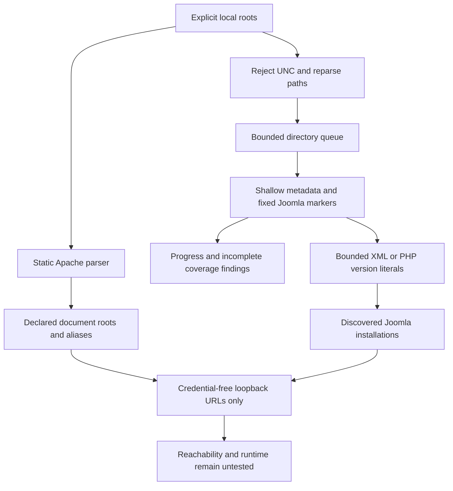
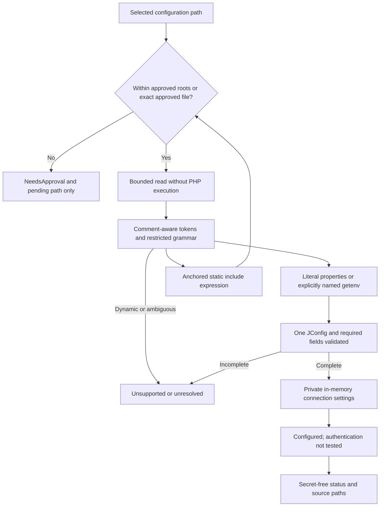
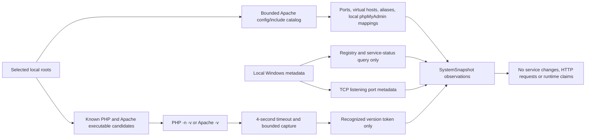

# Discovery boundaries

These diagrams describe the implemented discovery layer. Database inspection/recovery is a separate subsystem; a `Configured` result is not an authorization to mutate it.

Filesystem/registry deadlines are cooperative. Static Apache parsing does not evaluate module/conditional activation. Dynamic PHP is deliberately unsupported. Version commands are explicit diagnostic child processes with timeouts; the discovery scanner itself never executes project code.
